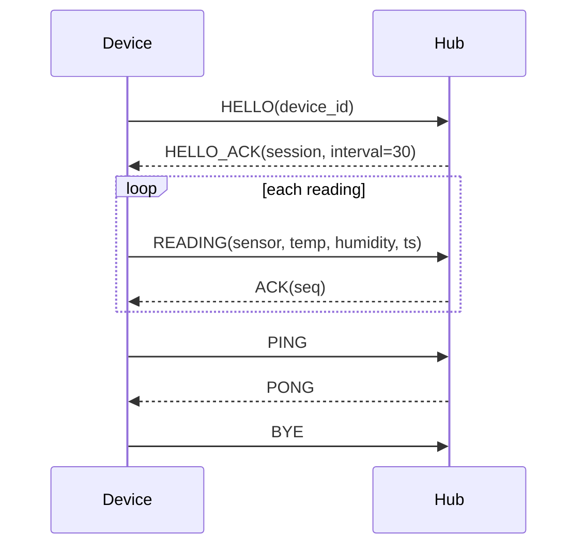

# Thermostat <-> hub protocol (reconstructed)

Capture: one TCP connection, thermostat `192.168.1.50:49152` -> hub `192.168.1.10:9100`, 26 packets, 11 application messages (6 device->hub, 5 hub->device). Byte order: big-endian. Status: all 11 frames decode and pass the checksum; see "Unknowns".

## Transport and framing
TCP is a byte stream, so frames are found by the length field and **can span TCP segments**: the third READING in this capture is split after 7 bytes. Reassemble each direction by sequence number before parsing (`decode_thermostat.py` does).

## Envelope (every message, both directions)

| Offset | Size | Type | Name | Meaning | Confidence | Evidence |
|---|---|---|---|---|---|---|
| 0 | 2 | bytes | magic | `A5 5A` | Confirmed | Start of all 11 frames; used to detect lost sync |
| 2 | 1 | u8 | type | Message type (table below) | Confirmed | 7 distinct values |
| 3 | 2 | u16 BE | seq | Sender's own message counter, starts at 1, +1 per message | Confirmed | device 1-6, hub 1-5, independent counters |
| 5 | 2 | u16 BE | length | Payload length in bytes | Confirmed | `length` + 9 = frame size for all 11 frames; streams consumed exactly |
| 7 | length | bytes | payload | Depends on type | Confirmed | |
| 7+length | 2 | u16 BE | crc | **CRC-16/CCITT-FALSE** (poly 0x1021, init 0xFFFF, no reflection, no final XOR) over bytes from `type` through the end of the payload (magic and the crc itself excluded) | Confirmed | Computed and matched on 11 of 11 frames; the other five common CRC-16 variants matched none |

## Message types

| Type | Name | Direction | Payload | Evidence |
|---|---|---|---|---|
| `0x01` | HELLO | device->hub | ASCII device id, no terminator (`THERM-7F3A`) | Printable text; length 10 |
| `0x02` | HELLO_ACK | hub->device | u32 session id (`0x00C0FFEE`), u16 interval (`30`) | Sent right after HELLO. The interval equals the 30 s spacing of the READING timestamps (Likely: report interval in seconds) |
| `0x10` | READING | device->hub | u8 sensor id; **i16 temperature in tenths of a degree C**; u8 humidity %; u32 Unix timestamp | Matches what you told me: `00 D7` = 215 -> 21.5 C, `2D` = 45%; `FF DD` = -35 -> -3.5 C, `50` = 80%; sensor 1, 1, 2 |
| `0x11` | ACK | hub->device | u16 sequence number being acknowledged | Equals the `seq` of the READING just before it (2, 3, 4) |
| `0x20` | PING | device->hub | empty | length 0 |
| `0x21` | PONG | hub->device | empty | length 0, follows PING |
| `0x7F` | BYE | device->hub | empty | Last message of the session |

Session shape: HELLO -> HELLO_ACK; then READING -> ACK repeated; PING -> PONG as keepalive; BYE to close.



## Worked example: the first READING (19 bytes)
```
A5 5A            magic
10               type READING
00 02            seq 2
00 08            length 8
01               sensor 1
00 D7            temp 215 -> 21.5 C
2D               humidity 45%
69 10 AA FE      timestamp 1762700030
A0 BE            crc16 over 10 00 02 00 08 01 00 D7 2D 69 10 AA FE
```

## Unknowns (and what would resolve them)
- **What the session id is used for.** It was never echoed in this capture. A longer capture, or one with a second session, would show.
- **Whether the interval is an instruction** (hub tells device how often to report) or a statement. Change the hub setting and re-capture.
- **Behaviour on errors:** bad CRC, missed ACK, unknown type, hub-initiated messages. This capture is a clean session. Capture a reconnect and a dropped packet.
- **Other sensor ids and the valid temperature range.** Only ids 1 and 2 were seen. The sign handling is confirmed for one negative value.
- **Whether HELLO_ACK's session id and the `seq` counters reset on reconnect.**
- Nothing here is encrypted or authenticated: there's no key, nonce or MAC field. That is an observation about this capture, and anyone on the network path could read or forge these frames.

<!-- Copyright (c) 2026 Likhon Sheikh - https://github.com/sheikhminds - MIT License -->
