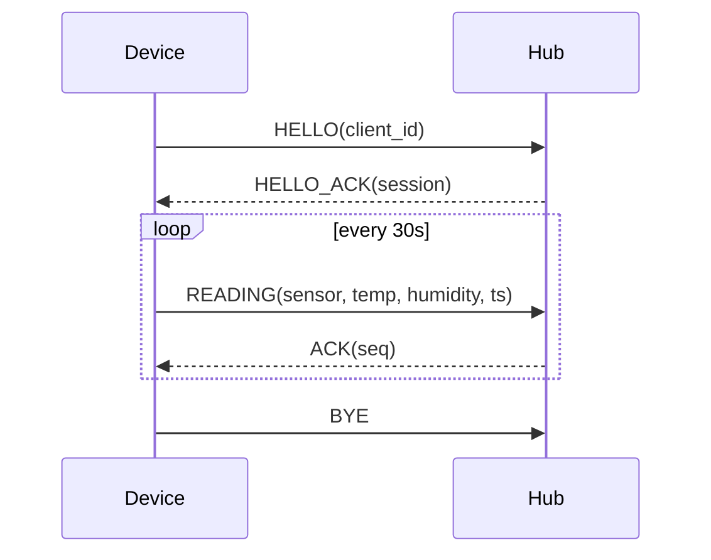

# Reverse engineering network protocols and undocumented APIs

Contents: 1. Ground rules - 2. Inputs - 3. Layered approach - 4. Finding message boundaries and structure - 5. Undocumented HTTP/REST APIs from HAR files - 6. State machines and sessions - 7. Encrypted traffic - 8. Deliverables - 9. Validation

Read `SKILL.md` first for scope and the core loop.

## 1. Ground rules

- Analyze **captures** the user made themselves or is authorized to have: their own device talking to their own hub, their own app talking to their own account, a lab setup. Don't send probe traffic to live third-party servers, and don't build tools to attack or bypass access controls.
- Secrets in captures (tokens, cookies, passwords, API keys, device IDs) must be **redacted** in everything you write, quote, or put in a spec. Replace them with placeholders such as `<TOKEN>` and say so.
- Validate any client you write against a **replay of the capture** or a local mock server you build, not against someone else's live service.

## 2. Inputs

| Input | How to read it |
|---|---|
| Classic `.pcap` | `python3 scripts/pcap_flows.py cap.pcap` lists flows; add `--flow N` to dump one flow's payloads by direction, and `--raw prefix` to save each direction's reassembled bytes. For `.pcapng`, convert first (`editcap -F pcap in.pcapng out.pcap`, or `tshark -F pcap`) or `pip install --break-system-packages scapy` |
| Wireshark/tshark text export or hex dump | Parse the hex into bytes yourself, keeping direction and timestamps |
| HAR file (browser/proxy export) | JSON: `log.entries[].request/response`. See section 5 |
| Application logs showing requests | Treat each line as a message; extract fields with regular expressions |
| Serial, USB, BLE traces | The same layered method applies. Framing and checksums are often the hard part |

With `tshark` present: `tshark -r cap.pcap -q -z conv,tcp` for conversations, `tshark -r cap.pcap -T fields -e frame.time_relative -e data.data` for raw payloads.

## 3. Layered approach

Peel the protocol one layer at a time, so that each layer's findings stay separate from the next.

1. **Transport.** TCP or UDP, ports, who initiates, how long connections live. UDP implies the protocol itself must handle loss, ordering, and often has sequence numbers.
2. **Framing.** How the receiver finds the start and end of each message in a byte stream: a delimiter (`\n`, `\r\n`, `0x00`), a **length prefix**, fixed-size frames, or a self-describing format (HTTP, JSON). TCP doesn't preserve message boundaries, so reassemble the stream before judging.
3. **Envelope.** The header common to all messages: magic or start byte, version, message type, length, sequence number, flags, checksum.
4. **Payload.** Per-message-type bodies: fixed structs, TLV, protobuf/MessagePack/CBOR, JSON, or text commands.
5. **Session.** Handshake, authentication, keepalives, request/response pairing, error handling, teardown.

## 4. Finding message boundaries and structure

**Start with what repeats.**

- Do all messages begin with the same byte(s)? That's a magic or start-of-frame marker.
- Take the first 4-8 bytes of every message and cluster them. Few distinct values at the same position indicates a **type** field. Count how many messages of each type there are.
- A value equal to `len(message) - header_size` (or the total length) is a **length field**. Test it on every message, including the shortest and longest.
- A value that increases by one per message in one direction is a **sequence number**. If the other side echoes it back, that pairs requests with acknowledgments.
- Bytes that differ on every message with no pattern are nonces, random IDs, or ciphertext. Constant bytes within a type are fixed fields, and constant bytes across types belong to the envelope.

**Column-wise analysis.** For messages of the same type, line them up byte by byte (pad shorter ones) and classify each column: constant, small set of values (enumeration or flags), monotonic (counter or timestamp), or variable. This quickly separates header from payload, and fixed fields from variable ones.

**Cross-check with the world.** If the user knows what the device was doing (set temperature to 21.5, pressed the button twice), look for those values. `scripts/probe.py` can interpret candidate offsets: 21.5 may appear as `0xD7` (215 as a 16-bit value scaled by 10), as a float, or as text.

**Checksums.** If the last 1-2 bytes of every message change unpredictably, they're probably a checksum or CRC. Test CRC-16 variants (CCITT, Modbus/ARC), CRC-32, sum, and XOR over the frame without the checksum field, then with and without the header (see `file-formats.md`, section 6).

**Text protocols.** If the payloads are readable (commands like `GET`, `SET temp 21.5\r\n`, JSON lines), document the grammar: commands, argument types, terminators, error replies.

## 5. Undocumented HTTP/REST APIs from HAR files

```python
import json
har = json.load(open("capture.har"))
for e in har["log"]["entries"]:
    r, s = e["request"], e["response"]
    print(r["method"], r["url"].split("?")[0], s["status"], s["content"].get("mimeType"))
```

Build an endpoint inventory:

- Method, path template (replace IDs with `{id}`), query parameters, request body schema, response schema, status codes seen.
- **Auth flow:** where tokens come from (login endpoint, cookie, header), how they're sent, whether they refresh, and how an expired token is reported. Describe the mechanism and don't copy any real token.
- Pagination style (page/offset, cursor), rate-limit headers, error response shape, required headers (versions, content negotiation).
- Derive schemas from multiple responses, not one: a field is optional if some responses lack it, and nullable if some show `null`.

Deliver an **OpenAPI 3** document when asked for a spec. Mark anything inferred from a single example as such in descriptions.

## 6. State machines and sessions

Write the session as a sequence, with one line per message: direction, type, key fields, and what it triggers. Then draw the state machine: states (connected, authenticated, streaming, closing), transitions, timeouts. A Mermaid diagram is a good deliverable:



Look for what the happy path hides: what happens on a bad checksum, a missed acknowledgment, a repeated sequence number, a reconnect. Captures that include an error or a retransmission are valuable, so ask for one.

## 7. Encrypted traffic

TLS-protected or custom-encrypted payloads can't be read from a capture alone, and trying to break them is out of scope. Options within scope:

- If the user controls both endpoints (their own app and device), they can supply a **TLS key log file** (`SSLKEYLOGFILE`) or capture at a point before encryption (a debug log, a proxy configured on their own device). Then analyze the plaintext as above.
- Metadata still carries a lot: message sizes, timing, direction, and cadence reveal heartbeats, bursts, and request/response pairing, and are enough to document behavior at a high level.
- A fixed, non-TLS protocol with high-entropy payloads and no key in sight: report that the payload is opaque and name what you'd need (the key, or analysis of the client that holds it, covered in `binaries.md` for software the user is authorized to analyze).

## 8. Deliverables

- **Message catalog:** a table per message type with the field layout (offset, size, type, name, meaning, confidence, evidence), taken from the template in `SKILL.md`.
- **Envelope and framing description** with the checksum algorithm and the exact byte range it covers.
- **Session description:** sequence diagram and state machine.
- **A decoder** (Python) that reads a capture and prints each message in readable form. Often more valuable than prose.
- **A replay client or mock server** to test the understanding, run only against the capture or a local mock.
- **OpenAPI file** for HTTP APIs, with secrets redacted.

## 9. Validation

- The decoder parses **every** message in the capture, with no leftover bytes and no checksum failures.
- Re-encode decoded messages and compare the bytes with the original.
- Check length and checksum rules on the longest and shortest messages, where off-by-one errors hide.
- State what's unverified: message types seen once, fields that never changed, behaviors that depend on states the capture doesn't contain.

<!-- Copyright (c) 2026 Likhon Sheikh - https://github.com/sheikhminds - MIT License -->
